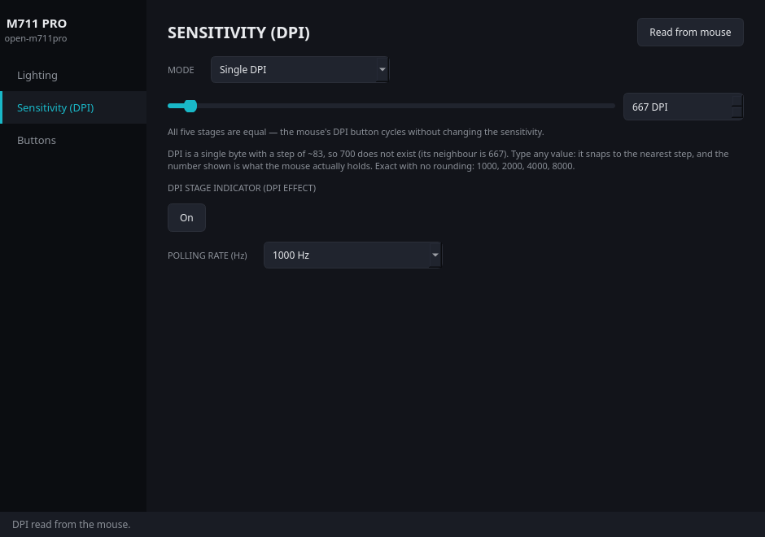
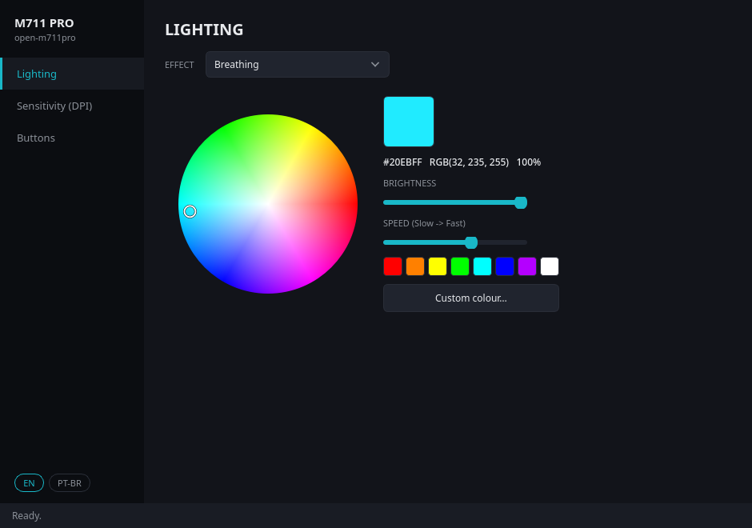
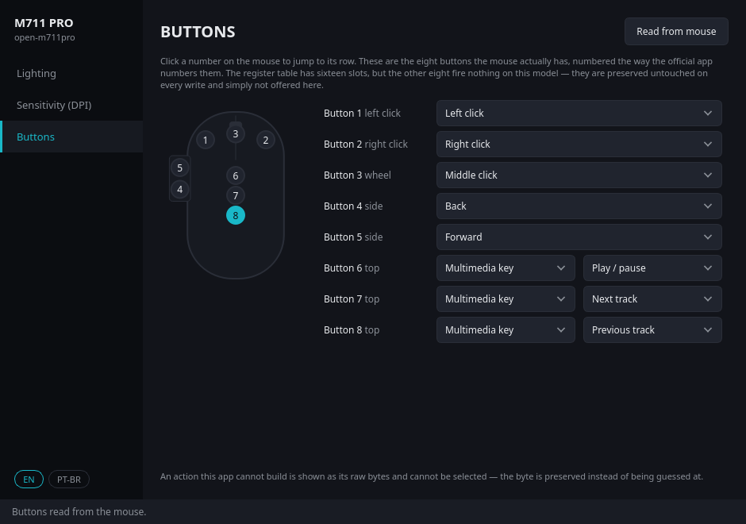

# open-m711pro

**🇺🇸 English** · [🇧🇷 Português](README.pt-BR.md)

[](https://github.com/mateusands/open-m711pro/actions/workflows/tests.yml)

**Configure your Redragon M711 Pro (Cobra Pro) mouse on Linux — no Windows
needed.** RGB lighting, DPI, polling rate, button remapping and macro-style key
combinations, from a GUI or the command line. The interface speaks English and
Brazilian Portuguese.

Redragon ships configuration software for Windows only. This project talks to
the mouse directly: the USB protocol was reverse-engineered by capturing the
official application's traffic with `usbmon` + Wireshark, and every byte is
verified against real hardware before it ships.

Written in pure Python, for **Linux** (it drives the mouse through `hidraw`).
The core has **no dependencies at all**; the graphical interface uses Qt
(PySide6) and is optional.

<p align="center">
  
</p>

> Not affiliated with or endorsed by Redragon. Use at your own risk.

## Does this work with my mouse?

Run `lsusb` and look for **`25a7:fa07`** or **`25a7:fa08`**:

```
Bus 001 Device 009: ID 25a7:fa07 Areson Technology Corp 2.4G Wireless Receiver
Bus 001 Device 033: ID 25a7:fa08 Areson Technology Corp 2.4G Dual Mode Mouse
```

| Role | VID:PID | USB description |
|------|---------|-----------------|
| 2.4G receiver (dongle) | `25A7:FA07` | 2.4G Wireless Receiver |
| Mouse (radio or cable) | `25A7:FA08` | 2.4G Dual Mode Mouse |

The mouse is sold as the **Redragon M711 Pro**, **M711-PRO** and **Cobra Pro**
depending on the market — the official software calls it COBRA PRO.

`25A7` is **Compx**, a common OEM for wireless gaming mice, so the protocol
family is shared with other devices. The Redragon **M913 Impact Elite** uses the
same chip and the same USB IDs; if you have one, look at
[m913-ctl](https://github.com/Qehbr/m913-ctl) and
[mouse_m908](https://github.com/dokutan/mouse_m908) first — parts of this
protocol were cross-checked against them.

If [libratbag](https://github.com/libratbag/libratbag) / Piper does not list your
Redragon, this is an alternative for this particular model.

> **Note:** the plain **M711 Cobra** (no "Pro") is a different mouse with a
> different chip (`04d9:fc30`) — this project does not support it.

## What works

- **LED** — solid colour, brightness, breathing, cycle, off, effect speed
- **DPI** — all five stages, independent X/Y in the wire format, single-DPI mode
- **DPI Effect** — the LED that indicates the current DPI stage
- **USB polling rate** — 1000 / 500 / 250 / 125 Hz
- **Buttons** — remap all eight: mouse buttons, DPI up/down/cycle, fire key,
  three-click, RGB toggle, polling switch, disable
- **Multimedia keys** — play/pause, next, previous, mute, stop, volume
- **Keyboard keys and combinations** — `key:a`, `combo:ctrl+c`, both verified
  byte for byte against what the official app writes
- **Reading the real state** back from the mouse, not just what this app wrote

Not mapped yet: **macros**, and the official app's **Neon** lighting effect. A
second LED block at `0x0054` accepts writes but lights nothing on this model
(see below).

## Requirements

- Linux, Python 3.8+
- The core is **pure stdlib**. The Qt interface needs `PySide6`; without it the
  app falls back to a tkinter UI.

## Platform support

**Linux only.** This is not a limitation of the packaging — the driver reads
`/sys/class/hidraw/`, opens `/dev/hidraw*` and drives it with the
`HIDIOCSFEATURE` ioctl, all of which are Linux kernel interfaces.

macOS has no hidraw; it exposes HID through IOKit, so a macOS port means writing
a second backend for `m711pro/core/device.py` (most likely over `hidapi`, a C
library — which would cost the core its zero-dependency property). Windows would
need the same for its HID API. The protocol layer, `m711pro/core/protocol.py`,
is pure logic and already portable; only the I/O module is tied to Linux.

If you want to take that on, the seam is deliberate and small: `find_devices`,
`_send_feature` and `_read_from` are the only functions that touch the kernel.

On Windows or macOS, [HIDra](https://github.com/luizjr/HIDra) (GPL-3.0) builds on
this project's protocol work and targets all three systems. We have not tested
it ourselves.

## Quick start

```bash
git clone https://github.com/mateusands/open-m711pro && cd open-m711pro
sudo sh packaging/install.sh   # lets your user reach the mouse; adds a menu entry
python3 main.py                # opens the interface
```

No build step: it is plain Python. The release downloads are the same code as a
Python package — if you took the `.whl`, install it with
`pipx install --system-site-packages open_m711pro-*.whl` and run
`open-m711pro setup` instead of the second line.

## Install

Installing is optional — `python3 main.py` from a checkout needs nothing. To
get the `open-m711pro` commands on your `PATH`, use
[pipx](https://pipx.pypa.io) from a checkout of this repository:

```bash
pipx install --system-site-packages .   # uses your distribution's PySide6
pipx install '.[gui]'                   # or pulls PySide6 from PyPI
```

Plain `pip install --user` is refused on Arch, Debian 12+, Ubuntu 23.04+ and
other distributions that mark their Python as externally managed (PEP 668);
pipx is the supported way around that.

This gives you `open-m711pro` (CLI) and `open-m711pro-gui` (graphical
interface); `python3 -m m711pro` works as well. Running from the source tree
with `python3 main.py` keeps working and needs no install at all.

Then grant access to the device and add the menu entry:

```bash
open-m711pro setup             # pip install or release download
sudo sh packaging/install.sh   # or, from a checkout
```

Either installs a udev rule for both product IDs (`25a7:fa07` and `25a7:fa08`),
reloads udev, and adds the app to the application menu. `setup` asks for `sudo`
only to copy the rule into `/etc`. Replug the mouse afterwards. Both are
idempotent, and `--uninstall` reverses them. Without the rule the app tells you
so: "this user cannot open it — the udev rule is not installed".

The rule uses `TAG+="uaccess"`, which hands the `hidraw` node to the user of the
active local session, rather than the `MODE="0666"` one-liner that would leave
the device world-writable for every account on the machine. See
[packaging/README.md](packaging/README.md) for the details and a fallback for
systems without systemd-logind.

### Per distribution

The core needs nothing beyond Python. These commands only install the optional
Qt interface from your package manager instead of pip — useful because a
distribution PySide6 tends to integrate better with the system theme.

**Arch, Manjaro, CachyOS, EndeavourOS**

```bash
sudo pacman -S --needed python python-pyside6
git clone https://github.com/mateusands/open-m711pro && cd open-m711pro
sudo sh packaging/install.sh
python3 main.py
```

**Debian, Ubuntu, Linux Mint, Pop!_OS**

```bash
sudo apt install python3 python3-pip python3-pyside6.qtwidgets
git clone https://github.com/mateusands/open-m711pro && cd open-m711pro
sudo sh packaging/install.sh
python3 main.py
```

Debian splits PySide6 into per-module packages, so the name may differ between
releases. Without PySide6 the app still runs, with its tkinter interface. If you plan to
use the tkinter interface instead, Debian and Ubuntu do **not** ship tkinter with
Python by default — install `python3-tk`.

**Fedora, RHEL, Nobara**

```bash
sudo dnf install python3 python3-pyside6
git clone https://github.com/mateusands/open-m711pro && cd open-m711pro
sudo sh packaging/install.sh
python3 main.py
```

**openSUSE**

```bash
sudo zypper install python3 python3-pyside6
git clone https://github.com/mateusands/open-m711pro && cd open-m711pro
sudo sh packaging/install.sh
python3 main.py
```

**Anything else**

```bash
git clone https://github.com/mateusands/open-m711pro && cd open-m711pro
python3 -m venv .venv && .venv/bin/pip install 'PySide6>=6.5'
sudo sh packaging/install.sh
.venv/bin/python main.py
```

Package names were taken from each distribution's current repositories and are
the part of this most likely to drift; if one is wrong on your system, the
virtual environment above is the universal path (or skip PySide6 and use the
tkinter interface), and a pull request fixing the name is welcome.

## Usage

Graphical interface:

```bash
open-m711pro-gui       # installed
python3 main.py        # from the source tree
```

The interface follows the system language on first run and can be switched in
the bottom-left corner (**EN / PT-BR**).

Command line (`python3 main.py` works the same way from the source tree):

```bash
open-m711pro FF0000         # red (hex)
open-m711pro 0 255 0        # green (R G B)
open-m711pro blue           # colour by name
open-m711pro off            # turn the LED off

open-m711pro dpi            # show the five stages read from the mouse
open-m711pro dpi 1600       # single DPI: apply it to all five stages
open-m711pro dpi 3 4000     # stage 3 = 4000 DPI
open-m711pro dpi-effect on  # DPI stage indicator LED

open-m711pro buttons        # list the 16 button slots
open-m711pro button 1 middle
open-m711pro button 9 media:mute
```

> DPI is stored as a single byte with a step of ~83, so 700 is really stored as
> ≈667 and 1600 as ≈1583. The bytes are exactly the ones the official app
> writes, and values are shown the way the app shows them — `700 DPI (≈667 real)`
> — so the number you typed stays on screen and the real one is still visible.
> 1000, 2000, 4000 and 8000 are exact.

## Troubleshooting

| Message | Cause and fix |
|---------|---------------|
| "this user cannot open it — the udev rule is not installed" | Run `open-m711pro setup` (or `sudo sh packaging/install.sh`), then replug the dongle. |
| "mouse not found" | The dongle is unplugged, the mouse is off, or a virtual machine holds the USB device. `lsusb` should list `25a7:fa07`. |
| "could not read …" / no answer | The mouse fell asleep or is out of range. Move it to wake it and try again; nothing was written. |
| The menu entry does nothing | Re-run the installer from the checkout you actually use: the entry points at that checkout's `main.py`. |

## The interface

<p align="center">
  
  
</p>

Click a number on the mouse diagram to jump to that button's row. The numbers
are the ones the official app uses — and they are deliberately not the table
indices, because the hardware does not order them the same way.

## Project layout

```
main.py                  entry point (GUI without args, CLI with args)
m711pro/
├── __main__.py          same dispatch for `python3 -m m711pro` + entry points
├── core/
│   ├── protocol.py      packet builders + checksums — PURE LOGIC, no I/O
│   ├── device.py        hidraw I/O (find_devices, send_*, read_*)
│   └── state.py         local persistence of the last applied state
├── cli/commands.py      command-line interface
├── system.py            `open-m711pro setup`: udev rule and menu entry
├── ui/
│   ├── qt.py            PySide6 interface
│   ├── i18n.py          interface text in English and Portuguese
│   ├── tk.py            tkinter fallback
│   └── theme.py         palette and visual constants
└── data/                colour names, HID keys, udev rule, .desktop entry
tools/                   memory dumper, DPI measurement, test runner
tests/                   byte-match tests against real captures
packaging/               install script for a checkout
```

Layer rules: `core/protocol.py` is pure logic and is what the byte-match tests
exercise; `core/device.py` is the only module that touches the hardware; the CLI
and the UIs never build packets themselves.

## Protocol

Configuration commands are **HID Feature Reports** on interface 1
(`bmRequestType 0x21`, `bRequest 0x09`, `wValue 0x0308`, 17 bytes), sent through
`ioctl(HIDIOCSFEATURE)` on the matching `/dev/hidraw` node.

```
08 07 00 <ADDR_HI> <ADDR_LO> <LEN> <data...> <padding> <CHECKSUM>
│  │  │  └────────┬────────┘  │
│  │  │           │           └── number of data bytes
│  │  │           └── 16-bit address in the mouse's config memory
│  │  └── always 00
│  └── opcode: 0x07 write · 0x04 commit · 0x08 read
└── Report ID (0x08)
```

**Checksum.** The byte sum settles at `0x55` (mod 256). This holds for the
17-byte packet *and* for every memory record independently:

```python
checksum = (0x55 - sum(previous_bytes)) & 0xFF
```

**Reading.** A read request is `08 08 00 <hi> <lo> <len>`; the reply arrives over
interrupt IN as Report ID `09` with the same layout.

### Register map

| Address | Contents |
|---------|----------|
| `0x0000` | USB polling rate: `01` 1000 Hz, `02` 500, `04` 250, `08` 125 |
| `0x0002` | number of enabled DPI stages (5) |
| `0x000C`–`0x001F` | DPI table: 5 stages × 4 bytes (`X Y 00 ck`) |
| `0x002C`–`0x003F` | per-stage LED colour: 5 × 4 bytes (`R G B ck`) |
| `0x004C` | DPI Effect: `01` steady, `00` off |
| `0x0060`–`0x009F` | button table: 16 records × 4 bytes (`TYPE P1 P2 ck`) |
| `0x0054`–`0x005F` | a second LED block — present, but see the note below |
| `0x00A0` | LED: `EFFECT R G B SPEED BRIGHTNESS ck` |
| `0x0100 + 0x20 x n` | extended slot for button *n* (multimedia, keyboard) |

### Which physical button is which index

The table has 16 slots; this mouse uses 8 of them, and **not in order**. Each row
below was proven by a single-variable experiment — assigning one action through
the official app and reading which record moved:

| Button in the app | Table index |
|-------------------|-------------|
| 1-5 (left, right, middle, back, forward) | 0-4 |
| 6 (behind the wheel, nearest) | 10 |
| 7 (behind the wheel, middle) | 11 |
| 8 (behind the wheel, furthest) | 9 |

Indices 5-8 and 12-15 are not reachable from the official interface. Index 6
holds `09 00 00` from the factory — an action type that appears in no table,
ours or m913-ctl's. Since no button maps to it, the app can never be used to
find out what it means. `read_buttons` returns raw bytes and `send_button`
preserves every record it was not asked to change, so it survives untouched.

### The second LED block (`0x0054`)

`0x0054`-`0x005F` mirrors the M913's main LED register: colour, mode, brightness
and speed, with the same record checksums. This mouse holds values byte-identical
to m913-ctl's "rainbow" template.

Writes are accepted and read back correctly, but **no visible change was ever
observed** — not with a different colour, not switching the mode from rainbow to
steady, not at full brightness. Either this model lacks the LED the block was
designed for, or it is gated by something we have not found. It is documented
here so nobody wastes time rediscovering it; the code does not touch it.

### DPI encoding

```python
byte = round(dpi * 3 / 250) - 1      # ~83.33 DPI per step
dpi  = (byte + 1) * 250 / 3
```

Validated against six values read off the official app and cross-checked with
the m913-ctl code table. The firmware ceiling is `0xBD` (~15833 DPI), which the
official app labels "16000".

### Button action types

| Type | Action | P1 | P2 |
|------|--------|----|----|
| `0x00` | disabled | — | — |
| `0x01` | mouse button | bitmask | — |
| `0x02` | DPI: `01` cycle, `02` up, `03` down | variant | — |
| `0x04` | repeated click (fire key / three-click) | speed | clicks |
| `0x05` | action lives in the extended slot | — | — |
| `0x07` | polling rate switch | — | — |
| `0x08` | RGB toggle | — | — |

### Extended slot: an event list

Actions that do not fit a 3-byte record live in a 32-byte slot at
`0x0100 + 0x20 x index`, holding a list of input events:

```
<event count> [ <type> <code lo> <code hi> ] x count <checksum>
```

| Type | Event | Code |
|------|-------|------|
| `0x80` / `0x40` | modifier press / release | HID modifier bits (ctrl `0x01`, shift `0x02`, alt `0x04`, win `0x08`) |
| `0x81` / `0x41` | key press / release | HID Keyboard Page usage |
| `0x82` / `0x42` | multimedia press / release | HID Consumer Page usage (16-bit) |

The first byte counts events, it does not name a type — which is why a plain key
is two events and a combination is four. Confirmed on this hardware: assigning
Ctrl+C through the official app produced

```
04 | 80 01 00 | 81 06 00 | 40 01 00 | 41 06 00 | c1
     ctrl down   c down     ctrl up    c up
```

with `0x01` the left-control bit and `0x06` the keyboard usage for "c" — both
standard HID values.

## Development

```bash
python3 -m pytest              # byte-match tests
python3 tools/run_tests.py     # same tests without pytest
python3 tools/dump_config.py   # read-only dump of the config memory
sudo python3 tools/measure_dpi.py   # measure the real DPI with a ruler (read-only)
```

Every packet builder has a byte-match test against a real capture. That is the
project's core rule: **no byte is ever sent to the hardware unless it has been
validated against a real capture or read back from the device.** A wrong packet
can leave the mouse in an odd state, and the `ioctl` succeeds either way.

## Credits

The reverse engineering here is our own, done by capturing the official
software's USB traffic. Two findings were cross-checked against, and corrected
by, prior work on the **same Compx chip** (identical USB IDs, `25a7:fa07`/`fa08`)
in the Redragon M913:

- [**m913-ctl**](https://github.com/Qehbr/m913-ctl) (GPL-3.0) — the 16-entry
  button table layout (we had read only 8) and the extended slot address
  `0x0100 + 0x20 × index`.
- [**mouse_m908**](https://github.com/dokutan/mouse_m908) (GPL-3.0) — the
  upstream protocol work that m913-ctl builds on.

Our DPI formula was independently validated against their code table. Where our
hardware disagrees with them, we follow our own measurements and say so in the
code. One such disagreement has since been settled in *their* favour: we had
`0x07`/`0x08` (RGB toggle vs polling switch) the wrong way round, which a
single-variable experiment on this mouse corrected. The LED mode bytes do
genuinely differ between the M913 and the M711 Pro.

## License

[GPL-3.0](LICENSE).
