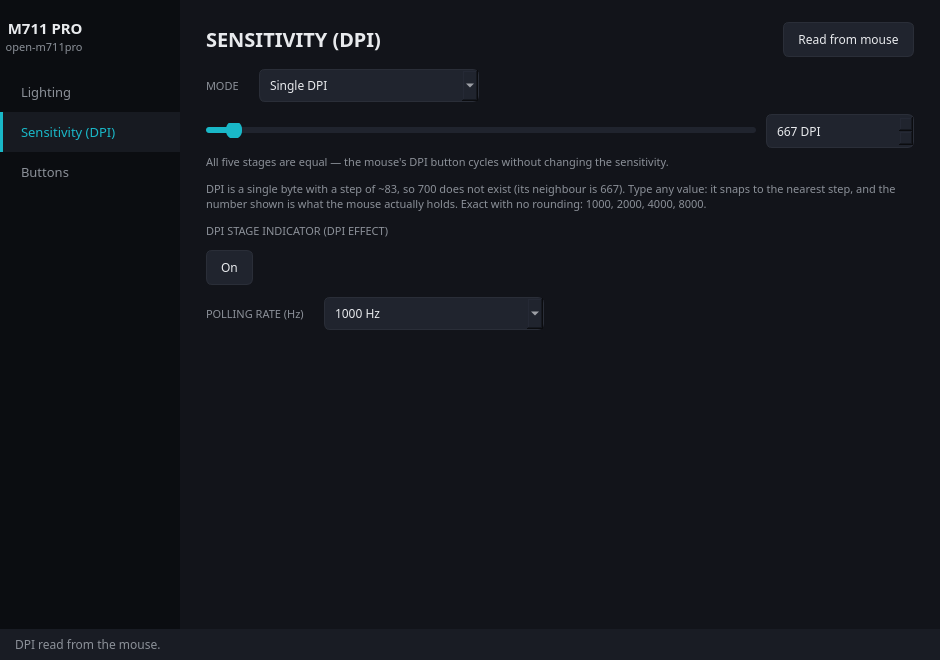
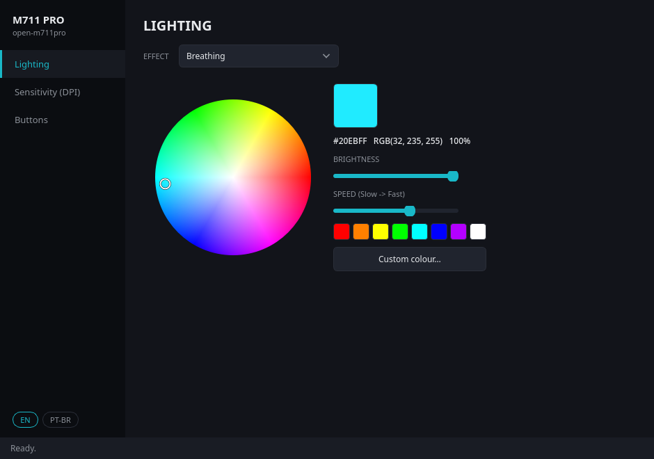
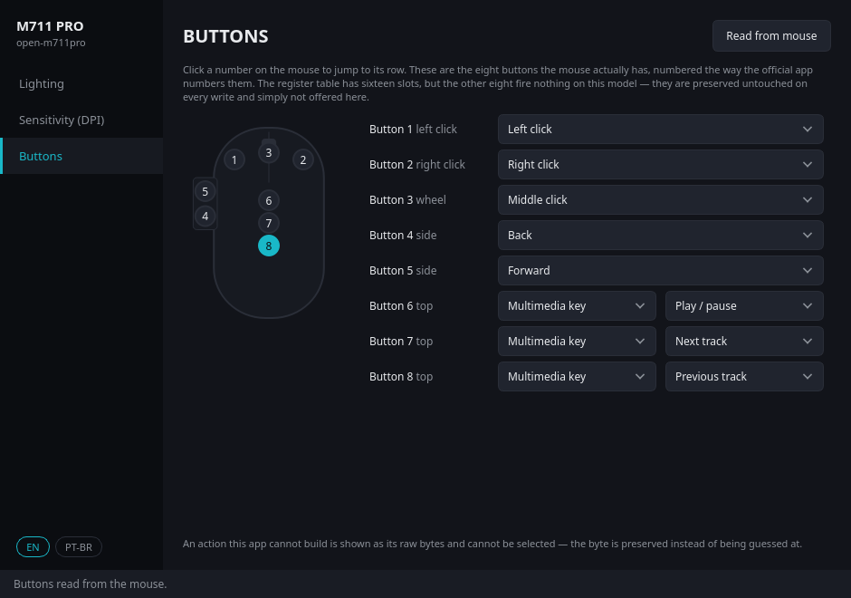

# open-m711pro

[🇺🇸 English](README.md) · **🇧🇷 Português**

[](https://github.com/mateusands/open-m711pro/actions/workflows/tests.yml)

**Configure o seu mouse Redragon M711 Pro (Cobra Pro) no Linux — sem precisar
de Windows.** Iluminação RGB, DPI, taxa de polling, remapeamento de botões e
combinações de teclas, por interface gráfica ou linha de comando. A interface
está em português e inglês.

A Redragon só oferece o software de configuração para Windows. Este projeto
conversa direto com o mouse: o protocolo USB foi descoberto por engenharia
reversa, capturando o tráfego do aplicativo oficial com `usbmon` + Wireshark, e
cada byte é conferido no hardware real antes de entrar no código.

Feito em Python puro, para **Linux** (o mouse é controlado via `hidraw`). O
núcleo **não tem nenhuma dependência**; a interface gráfica usa Qt (PySide6) e
é opcional.

<p align="center">
  
</p>

> Sem vínculo com a Redragon e sem endosso dela. Use por sua conta e risco.

## Começo rápido

```bash
git clone https://github.com/mateusands/open-m711pro && cd open-m711pro
sudo sh packaging/install.sh   # dá ao seu usuário acesso ao mouse e cria o atalho no menu
python3 main.py                # abre a interface
```

Não tem nada para compilar: é Python puro. **Você não precisa baixar os
arquivos da página de Releases** — eles são o mesmo código empacotado. Se já
baixou o `.whl`, instale com
`pipx install --system-site-packages open_m711pro-*.whl` e rode
`open-m711pro setup` no lugar da segunda linha.

## Funciona com o meu mouse?

Rode `lsusb` e procure **`25a7:fa07`** ou **`25a7:fa08`**:

```
Bus 001 Device 009: ID 25a7:fa07 Areson Technology Corp 2.4G Wireless Receiver
Bus 001 Device 033: ID 25a7:fa08 Areson Technology Corp 2.4G Dual Mode Mouse
```

| Papel | VID:PID | Descrição USB |
|-------|---------|---------------|
| Receptor 2.4G (dongle) | `25A7:FA07` | 2.4G Wireless Receiver |
| Mouse (rádio ou cabo) | `25A7:FA08` | 2.4G Dual Mode Mouse |

O mouse é vendido como **Redragon M711 Pro**, **M711-PRO** e **Cobra Pro**,
dependendo do mercado — o software oficial chama de COBRA PRO.

`25A7` é a **Compx**, fabricante comum de mouses gamer sem fio, então a família
do protocolo é compartilhada com outros aparelhos. O Redragon **M913 Impact
Elite** usa o mesmo chip e os mesmos IDs USB; se você tem um, veja primeiro o
[m913-ctl](https://github.com/Qehbr/m913-ctl) e o
[mouse_m908](https://github.com/dokutan/mouse_m908) — partes deste protocolo
foram conferidas com eles.

Se o [libratbag](https://github.com/libratbag/libratbag) / Piper não lista o seu
Redragon, este projeto é uma alternativa para este modelo.

> **Atenção:** o **M711 Cobra** comum (sem "Pro") é outro mouse, com outro chip
> (`04d9:fc30`) — este projeto não serve para ele.

## O que funciona

- **LED** — cor fixa, brilho, respiração, ciclo, desligado, velocidade do efeito
- **DPI** — os cinco estágios, eixos X/Y independentes, modo de DPI único
- **DPI Effect** — o LED que indica o estágio de DPI atual
- **Taxa de polling USB** — 1000 / 500 / 250 / 125 Hz
- **Botões** — remapeia os oito: botões de mouse, DPI +/−/alternar, tecla de
  disparo, três cliques, liga/desliga RGB, alternar polling, desativar
- **Teclas multimídia** — tocar/pausar, próxima, anterior, mudo, parar, volume
- **Teclas do teclado e combinações** — `key:a`, `combo:ctrl+c`, as duas
  conferidas byte a byte com o que o app oficial grava
- **Leitura do estado real** do mouse, não só do que este app gravou

Ainda não mapeado: **macros** e o efeito de iluminação **Neon** do app oficial.
Um segundo bloco de LED em `0x0054` aceita escrita mas não acende nada neste
modelo (veja abaixo).

## Requisitos

- Linux, Python 3.8+
- O núcleo é **só biblioteca padrão**. A interface Qt precisa do `PySide6`; sem
  ele, o app usa uma interface em tkinter.

## Plataformas

**Só Linux.** Não é limitação do empacotamento — o driver lê
`/sys/class/hidraw/`, abre `/dev/hidraw*` e usa o ioctl `HIDIOCSFEATURE`, tudo
interface do kernel Linux.

O macOS não tem hidraw; ele expõe HID pelo IOKit, então portar para macOS
significa escrever um segundo backend para `m711pro/core/device.py`
(provavelmente via `hidapi`, uma biblioteca em C — o que custaria ao núcleo a
ausência de dependências). O Windows precisaria do mesmo com a API HID dele. A
camada de protocolo, `m711pro/core/protocol.py`, é lógica pura e já é portável;
só o módulo de I/O é preso ao Linux.

Se quiser encarar isso, o ponto de corte é pequeno e proposital:
`find_devices`, `_send_feature` e `_read_from` são as únicas funções que falam
com o kernel.

No Windows ou macOS, o [HIDra](https://github.com/luizjr/HIDra) (GPL-3.0) parte
do protocolo deste projeto e atende os três sistemas. Não testamos ele.

## Instalação

Instalar é opcional — `python3 main.py` num clone não precisa de nada. Para ter
os comandos `open-m711pro` no `PATH`, use o [pipx](https://pipx.pypa.io) a
partir de um clone do repositório:

```bash
pipx install --system-site-packages .   # usa o PySide6 da sua distribuição
pipx install '.[gui]'                   # ou baixa o PySide6 do PyPI
```

O `pip install --user` comum é recusado no Arch, Debian 12+, Ubuntu 23.04+ e
outras distribuições que marcam o Python como gerenciado externamente (PEP
668); o pipx é o caminho suportado.

Isso cria `open-m711pro` (linha de comando) e `open-m711pro-gui` (interface
gráfica); `python3 -m m711pro` também funciona. Rodar do código com
`python3 main.py` continua funcionando, sem instalar nada.

Depois, libere o acesso ao dispositivo e crie o atalho no menu:

```bash
open-m711pro setup             # instalado via pipx ou baixado do Releases
sudo sh packaging/install.sh   # ou, a partir de um clone
```

Os dois instalam uma regra udev para os dois IDs (`25a7:fa07` e `25a7:fa08`),
recarregam o udev e colocam o app no menu de aplicativos. O `setup` só pede
`sudo` para copiar a regra para `/etc`. Reconecte o mouse depois. Os dois
podem ser rodados de novo sem problema, e `--uninstall` desfaz. Sem a regra, o
app avisa: "este usuário não tem permissão para abri-lo — a regra udev não está
instalada".

A regra usa `TAG+="uaccess"`, que entrega o nó `hidraw` ao usuário da sessão
local ativa, em vez do atalho `MODE="0666"`, que deixaria o dispositivo
gravável por qualquer conta da máquina. Veja
[packaging/README.md](packaging/README.md) para os detalhes e uma alternativa
para sistemas sem systemd-logind.

### Por distribuição

O núcleo não precisa de nada além do Python. Estes comandos só instalam a
interface Qt opcional pelo gerenciador de pacotes, em vez do pip — o PySide6 da
distribuição costuma combinar melhor com o tema do sistema.

**Arch, Manjaro, CachyOS, EndeavourOS**

```bash
sudo pacman -S --needed python python-pyside6
git clone https://github.com/mateusands/open-m711pro && cd open-m711pro
sudo sh packaging/install.sh
python3 main.py
```

**Debian, Ubuntu, Linux Mint, Pop!_OS**

```bash
sudo apt install python3 python3-pip python3-pyside6.qtwidgets
git clone https://github.com/mateusands/open-m711pro && cd open-m711pro
sudo sh packaging/install.sh
python3 main.py
```

O Debian divide o PySide6 em pacotes por módulo, então o nome pode mudar entre
versões. Sem o PySide6 o app continua funcionando, com a interface em tkinter.
Se for usar o tkinter, o Debian e o Ubuntu **não** trazem o tkinter junto com o
Python — instale o `python3-tk`.

**Fedora, RHEL, Nobara**

```bash
sudo dnf install python3 python3-pyside6
git clone https://github.com/mateusands/open-m711pro && cd open-m711pro
sudo sh packaging/install.sh
python3 main.py
```

**openSUSE**

```bash
sudo zypper install python3 python3-pyside6
git clone https://github.com/mateusands/open-m711pro && cd open-m711pro
sudo sh packaging/install.sh
python3 main.py
```

**Qualquer outra**

```bash
git clone https://github.com/mateusands/open-m711pro && cd open-m711pro
python3 -m venv .venv && .venv/bin/pip install 'PySide6>=6.5'
sudo sh packaging/install.sh
.venv/bin/python main.py
```

Os nomes de pacote vieram dos repositórios atuais de cada distribuição e são a
parte mais sujeita a mudar; se algum estiver errado no seu sistema, o ambiente
virtual acima é o caminho universal (ou dispense o PySide6 e use o tkinter), e
um pull request corrigindo o nome é bem-vindo.

## Uso

Interface gráfica:

```bash
open-m711pro-gui       # instalado
python3 main.py        # a partir do código
```

O idioma da interface segue o do sistema na primeira vez e pode ser trocado no
canto inferior esquerdo (**EN / PT-BR**).

Linha de comando (em inglês; `python3 main.py` funciona igual a partir do
código):

```bash
open-m711pro FF0000         # vermelho (hex)
open-m711pro 0 255 0        # verde (R G B)
open-m711pro blue           # cor pelo nome (em inglês)
open-m711pro off            # desliga o LED

open-m711pro dpi            # mostra os cinco estágios lidos do mouse
open-m711pro dpi 1600       # DPI único: aplica nos cinco estágios
open-m711pro dpi 3 4000     # estágio 3 = 4000 DPI
open-m711pro dpi-effect on  # LED indicador de estágio de DPI

open-m711pro buttons        # lista os 16 slots de botão
open-m711pro button 1 middle
open-m711pro button 9 media:mute
```

> O DPI é guardado num único byte com passo de ~83, então 700 fica guardado
> como ≈667 e 1600 como ≈1583. Os bytes são exatamente os que o app oficial
> grava, e os valores aparecem como no app — `700 DPI (≈667 real)` — para o
> número que você digitou continuar na tela e o real continuar visível. 1000,
> 2000, 4000 e 8000 são exatos.

## Problemas comuns

| Mensagem | Causa e solução |
|----------|-----------------|
| "este usuário não tem permissão para abri-lo — a regra udev não está instalada" | Rode `open-m711pro setup` (ou `sudo sh packaging/install.sh`) e reconecte o dongle. |
| "mouse não encontrado" | O dongle está desconectado, o mouse está desligado, ou uma máquina virtual capturou o dispositivo USB. O `lsusb` deve listar `25a7:fa07`. |
| "não foi possível ler…" / sem resposta | O mouse dormiu ou está fora de alcance. Mexa nele para acordar e tente de novo; nada foi gravado. |
| O atalho do menu não faz nada | Rode o instalador de novo a partir do clone que você realmente usa: o atalho aponta para o `main.py` daquele clone. |

## A interface

<p align="center">
  
  
</p>

Clique num número no desenho do mouse para ir à linha daquele botão. Os números
são os que o app oficial usa — e de propósito não são os índices da tabela,
porque o hardware não segue a mesma ordem.

## Estrutura do projeto

```
main.py                  ponto de entrada (interface sem argumentos, CLI com argumentos)
m711pro/
├── __main__.py          o mesmo despacho para `python3 -m m711pro` + entry points
├── core/
│   ├── protocol.py      montagem de pacotes + checksums — LÓGICA PURA, sem I/O
│   ├── device.py        I/O via hidraw (find_devices, send_*, read_*)
│   └── state.py         salva localmente o último estado aplicado
├── cli/commands.py      linha de comando
├── system.py            `open-m711pro setup`: regra udev e atalho no menu
├── ui/
│   ├── qt.py            interface PySide6
│   ├── i18n.py          textos da interface em inglês e português
│   ├── tk.py            interface alternativa em tkinter
│   └── theme.py         paleta e constantes visuais
└── data/                nomes de cores, teclas HID, regra udev, atalho .desktop
tools/                   dump da memória, medição de DPI, executor de testes
tests/                   testes de byte-match contra capturas reais
packaging/               script de instalação a partir de um clone
```

Regras de camada: `core/protocol.py` é lógica pura e é o que os testes de
byte-match exercitam; `core/device.py` é o único módulo que fala com o
hardware; a CLI e as interfaces nunca montam pacotes sozinhas.

## Protocolo

Os comandos de configuração são **HID Feature Reports** na interface 1
(`bmRequestType 0x21`, `bRequest 0x09`, `wValue 0x0308`, 17 bytes), enviados por
`ioctl(HIDIOCSFEATURE)` no nó `/dev/hidraw` correspondente.

```
08 07 00 <ADDR_HI> <ADDR_LO> <LEN> <dados...> <preenchimento> <CHECKSUM>
│  │  │  └────────┬────────┘  │
│  │  │           │           └── quantidade de bytes de dados
│  │  │           └── endereço de 16 bits na memória de configuração do mouse
│  │  └── sempre 00
│  └── opcode: 0x07 escrever · 0x04 aplicar · 0x08 ler
└── Report ID (0x08)
```

**Checksum.** A soma dos bytes fecha em `0x55` (mod 256). Isso vale para o
pacote de 17 bytes *e* para cada registro da memória, independentemente:

```python
checksum = (0x55 - sum(bytes_anteriores)) & 0xFF
```

**Leitura.** Um pedido de leitura é `08 08 00 <hi> <lo> <len>`; a resposta chega
pelo interrupt IN como Report ID `09`, no mesmo formato.

### Mapa de registradores

| Endereço | Conteúdo |
|----------|----------|
| `0x0000` | taxa de polling USB: `01` 1000 Hz, `02` 500, `04` 250, `08` 125 |
| `0x0002` | quantidade de estágios de DPI ativos (5) |
| `0x000C`–`0x001F` | tabela de DPI: 5 estágios × 4 bytes (`X Y 00 ck`) |
| `0x002C`–`0x003F` | cor do LED por estágio: 5 × 4 bytes (`R G B ck`) |
| `0x004C` | DPI Effect: `01` fixo, `00` desligado |
| `0x0060`–`0x009F` | tabela de botões: 16 registros × 4 bytes (`TIPO P1 P2 ck`) |
| `0x0054`–`0x005F` | um segundo bloco de LED — existe, mas veja a nota abaixo |
| `0x00A0` | LED: `EFEITO R G B VELOCIDADE BRILHO ck` |
| `0x0100 + 0x20 x n` | slot estendido do botão *n* (multimídia, teclado) |

### Qual botão físico é qual índice

A tabela tem 16 posições; este mouse usa 8 delas, e **fora de ordem**. Cada
linha abaixo foi provada por um experimento de variável única — atribuir uma
ação pelo app oficial e ler qual registro mudou:

| Botão no app | Índice na tabela |
|--------------|------------------|
| 1-5 (esquerdo, direito, meio, voltar, avançar) | 0-4 |
| 6 (atrás da roda, mais perto) | 10 |
| 7 (atrás da roda, no meio) | 11 |
| 8 (atrás da roda, mais longe) | 9 |

Os índices 5-8 e 12-15 não são acessíveis pela interface oficial. O índice 6
vem de fábrica com `09 00 00` — um tipo de ação que não aparece em nenhuma
tabela, nem na nossa nem na do m913-ctl. Como nenhum botão aponta para ele, o
app oficial não serve para descobrir o que significa. `read_buttons` devolve os
bytes crus e `send_button` preserva todo registro que não foi pedido para
mudar, então ele sobrevive intacto.

### O segundo bloco de LED (`0x0054`)

`0x0054`-`0x005F` espelha o registrador principal de LED do M913: cor, modo,
brilho e velocidade, com os mesmos checksums por registro. Este mouse guarda
valores idênticos, byte a byte, ao modelo "rainbow" do m913-ctl.

As escritas são aceitas e lidas de volta corretamente, mas **nenhuma mudança
visível foi observada** — nem com outra cor, nem trocando o modo de rainbow
para fixo, nem no brilho máximo. Ou este modelo não tem o LED para o qual o
bloco foi feito, ou ele depende de algo que não encontramos. Está documentado
aqui para ninguém perder tempo redescobrindo; o código não mexe nele.

### Codificação do DPI

```python
byte = round(dpi * 3 / 250) - 1      # ~83,33 DPI por passo
dpi  = (byte + 1) * 250 / 3
```

Validado com seis valores lidos na tela do app oficial e conferido com a tabela
de códigos do m913-ctl. O teto do firmware é
`0xBD` (~15833 DPI), que o app oficial chama de "16000".

### Tipos de ação de botão

| Tipo | Ação | P1 | P2 |
|------|------|----|----|
| `0x00` | desativado | — | — |
| `0x01` | botão de mouse | máscara de bits | — |
| `0x02` | DPI: `01` alternar, `02` +, `03` − | variante | — |
| `0x04` | clique repetido (disparo / três cliques) | velocidade | cliques |
| `0x05` | a ação fica no slot estendido | — | — |
| `0x07` | alternar taxa de polling | — | — |
| `0x08` | liga/desliga RGB | — | — |

### Slot estendido: uma lista de eventos

Ações que não cabem num registro de 3 bytes ficam num slot de 32 bytes em
`0x0100 + 0x20 x índice`, com uma lista de eventos de entrada:

```
<quantidade de eventos> [ <tipo> <código lo> <código hi> ] x quantidade <checksum>
```

| Tipo | Evento | Código |
|------|--------|--------|
| `0x80` / `0x40` | modificador aperta / solta | bits de modificador HID (ctrl `0x01`, shift `0x02`, alt `0x04`, win `0x08`) |
| `0x81` / `0x41` | tecla aperta / solta | código HID da página Keyboard |
| `0x82` / `0x42` | multimídia aperta / solta | código HID da página Consumer (16 bits) |

O primeiro byte conta eventos, não indica um tipo — por isso uma tecla simples
são dois eventos e uma combinação são quatro. Confirmado neste hardware:
atribuir Ctrl+C pelo app oficial gerou

```
04 | 80 01 00 | 81 06 00 | 40 01 00 | 41 06 00 | c1
     ctrl desce  c desce    ctrl sobe   c sobe
```

com `0x01` sendo o bit do Ctrl esquerdo e `0x06` o código de teclado do "c" —
os dois são valores HID padrão.

## Desenvolvimento

```bash
python3 -m pytest              # testes de byte-match
python3 tools/run_tests.py     # os mesmos testes, sem pytest
python3 tools/dump_config.py   # dump só-leitura da memória de configuração
sudo python3 tools/measure_dpi.py   # mede o DPI real com uma régua (só leitura)
```

Todo montador de pacote tem um teste de byte-match contra uma captura real.
Essa é a regra central do projeto: **nenhum byte vai para o hardware sem ter
sido validado contra uma captura real ou lido de volta do dispositivo.** Um
pacote errado pode deixar o mouse num estado estranho, e o `ioctl` diz que deu
certo de qualquer jeito.

## Créditos

A engenharia reversa aqui é nossa, feita capturando o tráfego USB do software
oficial. Duas descobertas foram conferidas e corrigidas com trabalhos
anteriores sobre o **mesmo chip Compx** (IDs USB idênticos, `25a7:fa07`/`fa08`)
no Redragon M913:

- [**m913-ctl**](https://github.com/Qehbr/m913-ctl) (GPL-3.0) — o formato da
  tabela de botões com 16 entradas (tínhamos lido só 8) e o endereço do slot
  estendido `0x0100 + 0x20 × índice`.
- [**mouse_m908**](https://github.com/dokutan/mouse_m908) (GPL-3.0) — o trabalho
  de protocolo original em que o m913-ctl se baseia.

A nossa fórmula de DPI foi validada de forma independente com a tabela de
códigos deles. Onde o nosso hardware discorda deles, seguimos as nossas medições e dizemos
isso no código. Uma dessas divergências acabou resolvida a favor *deles*:
tínhamos `0x07`/`0x08` (liga/desliga RGB e alternar polling) trocados, e um
experimento de variável única neste mouse corrigiu. Os bytes de modo do LED são
de fato diferentes entre o M913 e o M711 Pro.

## Licença

[GPL-3.0](LICENSE).
